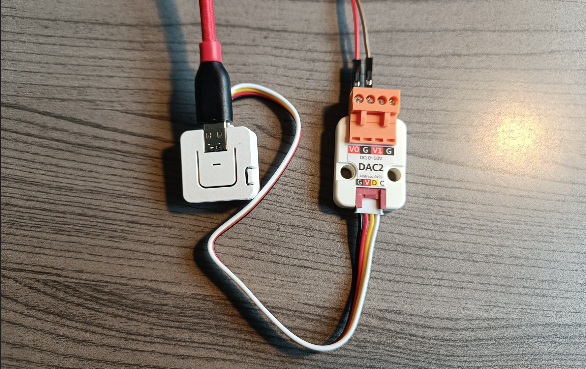

# Kalfire manual-session control

ESPHome 2026.10.0 external module for Kalfire's 0–10 V home-automation input.
The controls describe **requests**, not measured voltage, ignition success or flame
presence. It is not a thermostat and never restarts automatically when a room cools.

## Controls

- One `select` with mutually exclusive **Off / Manual / ECO** modes.
- A flame-height number, **1–8**, used only in Manual mode.
- An optional local session timeout, fixed or selected through a duration dropdown.
- An optional external-sensor temperature ceiling, independent of the timer.
- An optional boost switch: temporarily request maximum Manual output, then return.
- Optional diagnostics for remaining time, last stop reason and temperature readiness.

```yaml
external_components:
  # Use a published commit/tag containing this implementation.
  source: github://sillevl/esphome-components@<tested-commit>
  components: [kalfire]

select:
  - platform: kalfire
    id: fireplace_mode
    name: Fireplace mode

number:
  - platform: kalfire
    flame_height:
      name: Flame height

kalfire:
  id: fireplace
  output: fireplace_output

  # Optional. Omit for no session deadline; 0s is rejected.
  session_timeout: 90min

  # Optional. Reference an existing ESPHome sensor reporting degrees Celsius.
  # Omit this entire block for no temperature limit.
  temperature_limit:
    sensor: room_temperature
    ceiling: 23°C
    restart_margin: 0.5°C
    max_age: 5min
    unavailable_grace_period: 60s

  # Each diagnostic is independently optional.
  time_remaining:
    name: Session time remaining
  last_stop_reason:
    name: Last stop reason
  temperature_limit_status:
    name: Temperature limit status
```

The example above requires `fireplace_output` and `room_temperature` to be declared.
The values are illustrative, not recommendations for every room. The
[complete hardware example](../../kalfire_example.yaml) starts with both limits
omitted and includes commented configuration for adding them.

## Output and hardware

The output must be an ESPHome `output.FloatOutput` whose full scale represents
**10 V**. Do not invert it or apply `min_power`/`max_power` scaling: those options
change protocol voltages, potentially including the off command.

[M5Stack Unit DAC2](https://docs.m5stack.com/en/unit/Unit_DAC2) uses GP8413:

```yaml
gp8403:
  id: fireplace_dac
  model: GP8413
  voltage: 10V
  address: 0x59

output:
  - platform: gp8403
    id: fireplace_output
    gp8403_id: fireplace_dac
    channel: 0
```

The hardware combination documented by this repository is an
[M5Stack Atom S3](https://docs.m5stack.com/en/core/AtomS3) and Unit DAC2.



| Mode | Nominal requested voltage |
| --- | ---: |
| Off | 0 V |
| Manual, height 1–8 | 3–9 V, eight equal voltage steps |
| ECO | 9.5 V |

The manual-mode formula is `3 + 6 * (height - 1) / 7`. Changing height while in
ECO or Off stores the selection without changing mode. Invalid heights (including
fractional/non-finite values) are rejected. Mode changes do not reset height.

## Session timeout

Choose either a fixed `session_timeout` or the optional `session_duration` dropdown.
They cannot be configured together. Omitting **both** disables the timer, preserving
manual-only operation for existing configurations.

### Fixed duration

`session_timeout` remains fixed YAML configuration, **1 ms–24 h**. No changes to
existing fixed-timer YAML are required.

### Duration dropdown

Replace `session_timeout` with:

```yaml
kalfire:
  id: fireplace
  output: fireplace_output
  session_duration:
    name: Session duration
```

This adds a separate select entity alongside the Off/Manual/ECO mode control:

**15min · 30min · 45min · 1h · 1h30 · 2h · 3h · 4h**

The first-boot default is **1h**. A chosen duration is saved using ESPHome entity
preferences and restored on the Atom. Keep the entity identity stable when renaming
or replacing configuration if you want to retain that preference. Missing/invalid
saved data falls back to 1h. Only the duration is restored, never a running session.

ESPHome batches flash writes according to its `preferences.flash_write_interval`.
A sudden power loss before a pending write reaches flash can lose the most recent
selection; this module does not force immediate flash writes on every change.

A change applies **only to the next session**. Shorter and longer selections both
leave the current countdown unchanged. The selected label is therefore the next
session's duration; `time_remaining` continues to show the actual active countdown.
Changing the dropdown while Off does not start the fireplace.

### Shared session behaviour

A session begins only on Off → Manual/ECO and snapshots the configured/selected
duration at that moment. Switching between active modes, changing height, or
repeating the current active mode does not reset the deadline. A deliberate Off
followed by a new start creates a new session using the latest duration.

Expiry requests 0 V and publishes Off. There is no automatic restart. A mode command
received after an unprocessed deadline first ends that expired session; a subsequent
explicit start is needed. No extend-session action or persistent session restoration
is implemented.

The timer runs on the **Atom's monotonic clock**, not in Home Assistant, so an HA
reboot does not reset it. The Atom must remain powered and running. Its own reboot
always returns to Off; no burning session is restored from flash.

ESPHome's API connection watchdog can reboot the Atom during a sufficiently long
HA outage. To keep the local session running through such an outage, explicitly use:

```yaml
api:
  reboot_timeout: 0s
```

This is a device configuration choice; the module does not silently alter API or
Wi-Fi settings. A Wi-Fi watchdog or other reboot can still stop a session via
startup-off. With a temperature limit sourced from HA, a prolonged HA outage can
also end the session through the temperature-freshness limit, as intended.

## Optional boost

Add this inside your existing `kalfire` block:

```yaml
kalfire:
  id: fireplace
  output: fireplace_output
  session_duration:
    name: Session duration
  boost:
    name: Boost 10min
    duration: 10min  # Optional; defaults to 10min. Range: 1ms–24h.
    active:         # Optional redundant binary diagnostic; existing YAML can keep it.
      name: Boost active
    time_remaining:  # Optional boost-only countdown, seconds rounded up.
      name: Boost time remaining
```

Omitting `boost` disables it. It works with either the duration dropdown, a fixed
session timeout, or neither. No new secrets or HA automation are required.

Turning the boost switch On temporarily requests **Manual at level 8 (9 V)**. There is no level
9: 9.5 V is the separate ECO protocol. Boost time starts at the accepted command,
not at confirmed ignition; no actual flame feedback is available.

The normal flame-height number remains your selected **post-boost height**. It is
not changed to 8 during boost. The mode select reports Manual and the boost switch
reports the actual internal override state. The optional `active` binary diagnostic
can be retained for existing dashboards but is no longer necessary.

| Before boost | At normal boost completion |
| --- | --- |
| Off | Off (`last_stop_reason`: `Boost complete`) |
| Manual | Manual at the unchanged selected height |
| ECO | ECO, retaining the normal height selection |

- Boost from Off starts a new session using the currently configured/selected duration.
- Boost during an active session **never resets or extends its deadline**.
- Session expiry, temperature ceiling and unavailable-temperature grace expiry take
  priority over boost completion. They cancel boost and never restore a previous
  active mode afterward. Cooling or sensor recovery does not restart anything.
- An accepted explicit mode command (including Manual again), or a valid height
  command, cancels boost. Your new command wins; no delayed restoration remains.
- Turning the **boost switch Off** ends boost immediately and returns to the
  pre-boost mode/normal height, provided no session/temperature cutoff has won.
  For a boost started from Off this stops the fireplace with stop reason `User`.
- Selecting **mode Off** instead always stops the fireplace, with no restoration.
  Rejected/invalid commands leave boost unchanged.
- Repeated boost On commands do not extend the boost deadline or replace the saved
  mode. An On arriving after an unprocessed deadline first completes the old boost;
  a subsequent explicit On is needed to start a new one.
- The switch automatically reports Off on timeout, manual takeover or a limit stop.
  It is controller-owned, not optimistic. It always initializes Off: only
  `restore_mode: ALWAYS_OFF` is accepted, and inversion is not supported.
- Atom reboot always returns Off, with no boost/session restoration. HA reconnect
  does not itself start boost. Both countdowns run locally.

The session `time_remaining` and `boost.time_remaining` have different meanings:
the former is the actual session cutoff; the latter is when maximum-output override
ends. Boost remaining is zero while inactive. With no session timeout configured,
the session remaining sensor stays unknown, but boost still has its own deadline.

### Migration from the boost button

The `boost:` YAML block, duration and optional diagnostics can stay as they are.
It now creates a **switch**, not a button. Update dashboards/automations referencing
`button.*` to the newly created `switch.*` entity and use `switch.turn_on`,
`switch.turn_off` or toggle instead of `button.press`. If you configured `on_press`,
replace it with an appropriate switch callback (`on_turn_on`/`on_turn_off`), without
adding automatic ignition retries. The obsolete button entity may remain unavailable
in HA; the firmware does not edit HA's registry.

Keep first tests supervised. Boost is a convenience, not a thermostat, certified
safety control, or automatic fault-reset/ignition-retry mechanism.

## Temperature ceiling

`temperature_limit.sensor` can refer to any ESPHome sensor, including a local probe
or a sensor imported through Home Assistant. Its **values must be Celsius**; changing
unit metadata alone does not convert a Fahrenheit source.

- `ceiling` is required and finite; ESPHome temperature-unit syntax is supported.
- `restart_margin` defaults to **0.5°C**, must be finite and non-negative.
- `max_age` defaults to **5 min**, accepts **1 ms–24 h**.
- `unavailable_grace_period` defaults to **60 s**, accepts **0–24 h**.

A start is blocked without a fresh, finite reading, or if the ceiling has been
reached. During a session, reaching the ceiling immediately requests Off. After
hitting the ceiling, the temperature must be at or below `ceiling - restart_margin`
before another manual start is accepted. Cooling below this point **does not start
a session**.

An invalid publication or stale reading marks temperature unavailable. New starts
and active-mode changes are rejected while unavailable; an already running session
can continue only through the configured grace period. On expiry it requests Off.
Repeated invalid readings do not renew grace. Recovery within grace preserves the
session; recovery after expiry cannot revive it. A 0s grace stops immediately.

### What freshness does and does not mean

The module requires a sensor publication **after its setup**, rather than adopting
a cached startup value. `max_age` measures time since the latest received filtered
publication. It cannot establish the timestamp of the original physical measurement.

Use a source with meaningful periodic measurements/publications and availability
handling. A Home Assistant sensor may publish only on changes: a healthy, steady
room temperature can then go stale and end a session. Choose/report at the source
accordingly. Do not add a synthetic heartbeat that blindly republishes cached values
and call those fresh physical measurements. Merely reconnecting HA can also deliver
cached state; this interface cannot distinguish it from a new measurement.

## Diagnostics and callbacks

- `time_remaining`: seconds, rounded up. Zero when a timed session is off; unknown
  (`NaN`) if the timeout is disabled. Does not prove a physical flame has stopped.
- `last_stop_reason`: `Startup`, `User`, `Timeout`, `Temperature ceiling`,
  `Temperature unavailable`, or `Boost complete`. Remains the last stop reason during the next session;
  a rejected start does not overwrite it.
- `temperature_limit_status`: `Disabled`, `Ready`, `Too warm`, or `Unavailable`.

State/output are updated before callbacks. Newer nested mode/height/boost commands are
not overwritten by older outer commands. Start attempts from synchronous startup
or stop-publication callbacks are rejected, including timeout-stop notifications.
This is not a security barrier against a separate automation repeatedly issuing new
start commands later. Do not configure automations to retry ignition or restart after
limit-triggered stops.

## Migration from the two switches

This is an intentional interface change from commit `1d9e1ff`:

1. Remove `switch: - platform: kalfire` with its `flame`/`eco_mode` entries.
2. Add the `select: - platform: kalfire` block above.
3. Keep the existing flame-height number.
4. Update dashboards and automations: select `Off`, `Manual`, or `ECO` rather than
   calling either old switch. Turning off ECO is now an explicit `Manual` selection.
5. Remove the earlier per-device startup workaround; startup is module-owned.

Legacy switch YAML gives a migration error. The old switch entities will no longer
be supplied by the firmware; this code does not remove them from HA's registry.
The mode select has no restoration/inversion options and always initializes Off.

## Safety boundaries

Kalfire documents 0 V for off, 3–9 V modulation and 9.5 V ECO in the
[G/GP installation manual, section 5.12.1, page 23](https://kalfire.com/downloads/Handleidingen/Gashaarden/G%20and%20GP/Installation%20manual%20Kalfire%20G-GP_EN_V03_2026.pdf).
This is the published 2026 manual. Confirm the applicable instructions/controller
revision for older fireplaces, including units installed in 2021. Equal voltage
steps do not imply equal heat output or exact remote-level equivalence.

These optional limits are **operational guardrails, not certified safety controls**.
The float-output interface cannot acknowledge a DAC write or confirm flame state.
The DAC may retain voltage before initialization, on MCU crash, power loss or I2C
failure. Startup requests 0 V at PROCESSOR priority, after GP8403/GP8413 DATA setup;
other output implementations must be ready beforehand. No special shutdown handler
is added. A blocked event loop also delays limits until execution resumes.

Have the manufacturer's home-automation wiring verified by a qualified installer.
The manual specifies at least 2 mA at the KA-02 input: verify capability and voltage
under load. Retain the burner controller and interlocks. Never bypass ignition
lockouts, automate fault resets, or directly control the gas valve. The remote remains
necessary for the documented fault-reset procedure. Hybrid lighting, actual flame
feedback, gas-budget enforcement and thermostat regulation are not implemented.

See [tests/README.md](../../tests/README.md) for regression tests and build fixtures.
Nothing reaches an installed device until changes are published, firmware is built,
and an upload is explicitly performed.
